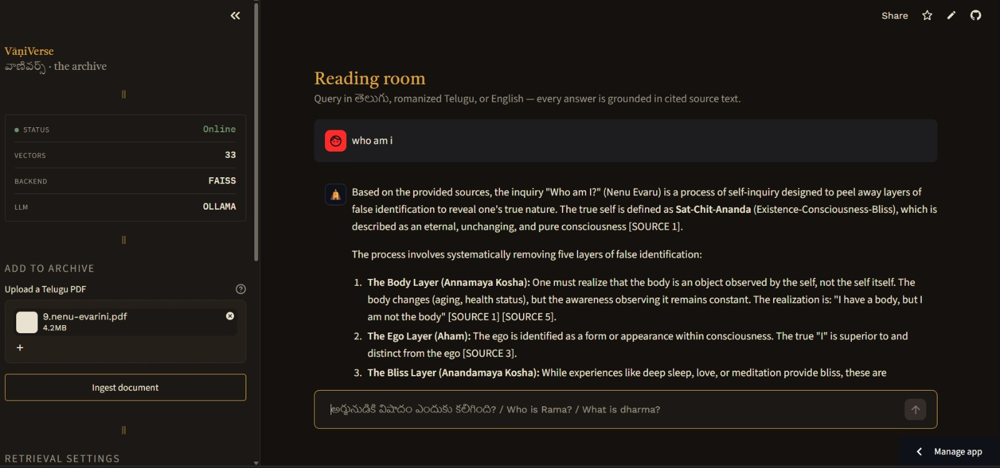
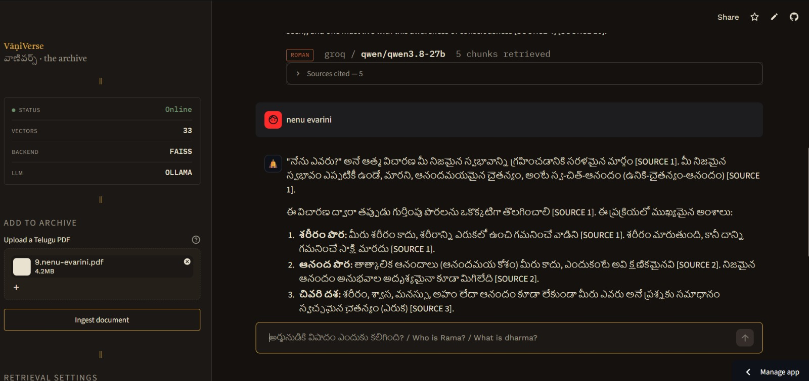
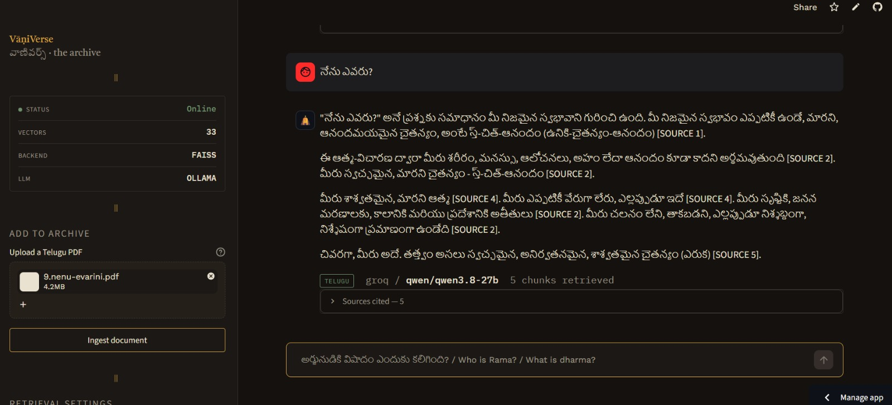
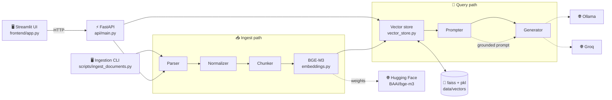
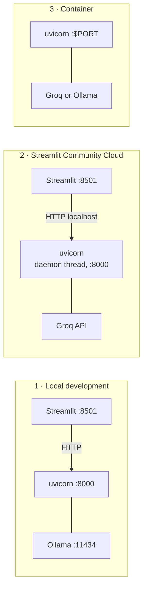
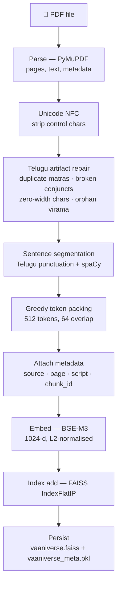
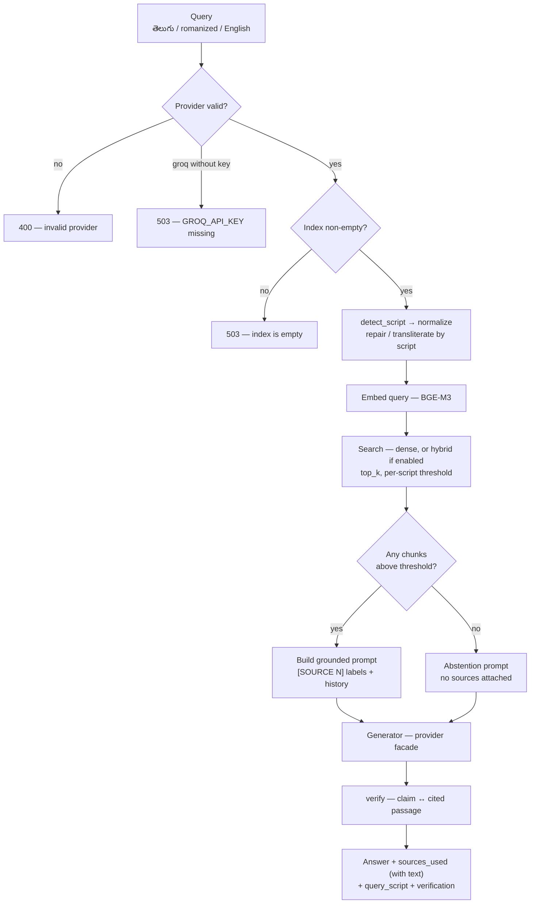
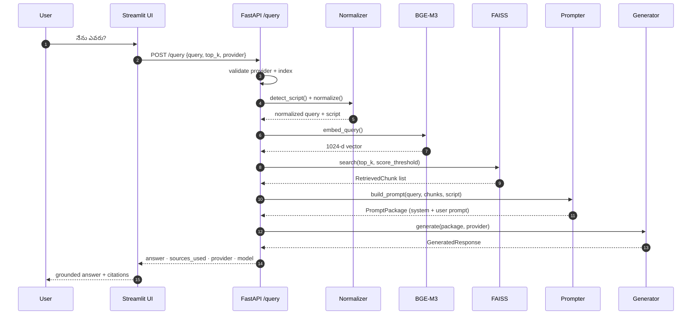

<div align="center">


# VāṇiVerse

**Source-grounded retrieval and reasoning for India's linguistic heritage.**

`తెలుగు` · *Romanized Telugu* · English

<br/>

### ▶️ [**Try the live demo →**](https://vaaniverse-27.streamlit.app/)

<br/>

[](https://vaaniverse-27.streamlit.app/)
[](https://python.org)
[](https://fastapi.tiangolo.com)
[](https://streamlit.io)
[](https://huggingface.co/BAAI/bge-m3)
[](https://github.com/facebookresearch/faiss)
[](https://groq.com)
[](#testing)
[](LICENSE)

</div>

---

## What is VāṇiVerse

VāṇiVerse is a **multilingual Retrieval-Augmented Generation (RAG)** platform for Telugu and
other Indic heritage content. Ask a question in **Telugu**, **Romanized Telugu**, or **English**
and get an answer built *only* from retrieved source passages, with the source and page cited.
The answer comes back in the language you asked in: a Romanized Telugu question is answered in
Telugu script, an English one in English.

Modern retrieval systems are built for globally digitised, script-uniform text. Heritage corpora
break that assumption: the same query arrives as `రామ ఎవరు` or `rama evaru`, PDF extraction mangles
Telugu conjuncts, and the "right answer" is often a passage rather than a fact. VāṇiVerse treats
those as first-class problems.

| The problem | What VāṇiVerse does |
| --- | --- |
| Same query, different scripts | Script detection + Romanized-Telugu transliteration before embedding |
| Answers in the wrong language | English and Romanized Telugu are both "roman" to the script detector; they are separated before the prompt is chosen, so each gets its own answer language |
| Telugu PDFs extract badly | Unicode artifact repair (duplicate matras, broken conjuncts, zero-width chars) |
| Some pages are just pictures | OCR fallback (Tesseract / EasyOCR) for pages with no usable text layer |
| Generic splitting destroys context | Sentence-aware, overlap-aware chunking with per-chunk metadata |
| One threshold for every script | Per-script, measured score thresholds — native Telugu embeds closer to the corpus than roman or English does, so a single cutoff silently rejects English questions retrieval ranked correctly |
| Model answers from memory | Evidence-only prompting; abstains when sources don't cover the question |
| Answers can't be verified | Every response returns `sources_used` with source, page, score **and the cited passage**, plus a claim-by-claim verification verdict |
| A follow-up question has no context | Client-supplied conversation history is passed as real chat turns — never as sources, so it cannot be cited |
| Destructive endpoints were open | `/ingest` and `/index/reset` require `X-API-Key` once `VANIVERSE_API_KEY` is set; `/health` reports `auth_configured` |

> **Live demo:** <https://vaaniverse-27.streamlit.app/> — hosted on Streamlit Community Cloud.
> There is no Ollama there, so it runs the **Groq** provider, and the container disk is ephemeral:
> upload a Telugu PDF in the sidebar and click **Ingest document** to build the index before asking.
> The first ingest downloads BGE-M3 (~2.2 GB) and embeds on CPU, so give it a few minutes.

> **Status:** Phases 1–2 complete — the end-to-end pipeline runs, the API and UI are live, the
> provider switch (Ollama ⇆ Groq) is implemented and tested, and retrieval is measured at
> **91.9% recall@5** against a 15% random baseline on a 53-question gold set
> ([docs/EVALUATION.md](docs/EVALUATION.md)). Phase 3 (robustness) is in progress: the
> Romanized-Telugu transliteration fix is **done** (romanized recall 60% → 100%), OCR-first ingestion
> for image-only pages is **shipped** as a pluggable engine layer ([docs/OCR.md](docs/OCR.md)),
> per-script relevance thresholds are **calibrated from measurement** (in-corpus gate passage
> 81.1% → 94.6%), and the cross-encoder reranker is implemented, **measured end-to-end, and off by
> default** — it buys one question in 30 for +77 s/query on CPU. Languages beyond Telugu/English
> remain a roadmap item. See [Known limitations](#known-limitations).

---

## Proof of work — answer generation

Ask a question in **Telugu**, **Romanized Telugu**, or **English** against the sample book and check
the grounded answer plus its citations.

**Sample book for testing:** [**who-am-i-telugu** — *Who Am I?* (Telugu, Archive.org)](https://archive.org/details/who-am-i-telugu)

One command downloads and ingests it, so a fresh clone is not a dead app:

```bash
python -m scripts.load_sample          # download + ingest + persist the index
python -m scripts.load_sample --dry-run  # parse and chunk only, no embedding
```

Or upload any Telugu PDF in the sidebar. The PDF is not committed (third-party, and `data/` is
gitignored), which is why a script does the fetching.

> **Do not add the sample to an index you evaluate against.** `eval/gold_qa.jsonl` matches answers by
> **page number** only, and this is a different book that also starts at page 1. Run
> `DELETE /index/reset` first if you want the published numbers to reproduce.

<br/>

**1 · Ingest the sample book**



**2 · Retrieve grounded passages**



**3 · Generate the answer**



---

## Architecture

The codebase is split into four responsibilities — **interface → application → domain → infrastructure** —
so that swapping the vector store, the embedding model, or the LLM never touches HTTP code.



**The layers, and why they are drawn this way:** `api/main.py` owns orchestration — it imports
every service but no service imports it. `VectorStore` hides FAISS vs Qdrant behind one interface,
and `Generator` hides Ollama vs Groq behind another. Nothing in the API or UI knows which backend
is active; that decision lives in `core/config.py` (`LLM_PROVIDER`) and in the per-request payload.

---

## Deployment topologies

The UI talks to the API over HTTP on `http://localhost:8000`. Where that API runs is a deployment
choice, and the app supports all three:



| Topology | How the API starts | Typical provider |
| --- | --- | --- |
| **Local** | `uvicorn api.main:app` as a separate process | Ollama (offline, private) |
| **Streamlit Cloud** · [live ↗](https://vaaniverse-27.streamlit.app/) | `frontend/app.py` calls `ensure_api_ready()`, which boots uvicorn on a daemon thread inside the Streamlit process | Groq (no local GPU/Ollama available) |
| **Container** | `Dockerfile` + `docker run`, or any platform that injects `$PORT` | Groq or a networked Ollama |

Streamlit Community Cloud runs **one process**, so a separate backend is impossible there. The UI
therefore detects a missing API and starts one in-process — this is why `frontend/app.py` imports
`uvicorn` and `api.main`. `API_BASE_URL` stays overridable via the `VANIVERSE_API_URL` environment
variable or a Streamlit secret, so pointing at a remote API later needs no code change.

### Streamlit Cloud secrets

The UI copies flat string secrets into the environment *before* the embedded API is
imported, because `core/config.py` reads its configuration at import time — that is why
the bridge sits at the top of `frontend/app.py`. Paste this into
**App → Settings → Secrets**:

```toml
GROQ_API_KEY = "gsk_..."   # required: the only provider reachable with no local server
LLM_PROVIDER = "groq"      # optional: see below
```

`GROQ_API_KEY` is the one that matters. `LLM_PROVIDER` is belt-and-braces: `/health`
reports `ollama_reachable`, and the sidebar drops Ollama from the provider list when
nothing answers on `OLLAMA_BASE_URL`, so the default falls through to Groq on its own.
`GROQ_MODEL` overrides the model id, whose default is listed under
[Configuration](#configuration) and which Groq retires on its own schedule — a retired id
returns `404 model_not_found`, which the API now reports verbatim rather than as a bare
"call failed".

Secrets are never committed: `GROQ_API_KEY` is read from the environment only, and
`.env.example` ships an empty placeholder.

---

## Ingestion pipeline

Turns a PDF into searchable, citation-ready vectors.



Because vectors are L2-normalised, FAISS inner product **is** cosine similarity — that is why the
`/search` and `/query` scores in the UI are directly interpretable (0.55–0.65 is a strong match for
this corpus).

Each chunk carries the metadata below, which is what makes citations possible later:

| Field | Example | Purpose |
| --- | --- | --- |
| `chunk_id` | `book_p4_0` | Stable identifier, returned to clients |
| `source` | `book.pdf` | Cited filename |
| `page_number` | `4` | Cited page |
| `script` | `telugu` | Drives answer-language policy |
| `chunk_index` | `0` | Order within the page |
| `text` | `…` | The retrievable passage |

---

## Query pipeline

Turns a question into a grounded, cited answer — or an honest abstention.



The round trip, step by step:



### The two content languages

Normalization is **script-aware**, not one-size-fits-all — this is the part that decides whether a
query is transliterated or left alone:

| Detected script | Trigger | Handling |
| --- | --- | --- |
| `telugu` | Telugu codepoints > 60% of letters | Unicode repair only — already native script |
| `roman` + English stopwords | ≥ 2 English function words | **No transliteration** — protects "who am I" from being mangled |
| `roman` (not English) | otherwise | Phrase map, then the abugida-aware state machine |
| `mixed` | neither threshold met | Full transliteration to Telugu |
| `unknown` | no letters at all | Passed through |

The English-stopword guard exists because transliterating `who am i` syllable-by-syllable produces
garbage. `detect_script()` runs on the **raw** query, before normalization, so the decision is never
based on already-mutated text.

> **Note on the abugida rules.** Telugu consonants carry an inherent `a`, and any other vowel is a
> dependent sign attached to that consonant — so a flat letter-by-letter substitution cannot work.
> The state machine emits matras after consonants, a virama in clusters, and anusvara for word-final
> `m`, which is what turns `eruka` into `ఎరుక` rather than `ఎరఉకఅ`. Plain `t`/`d`/`n` follow the
> ISO 15919 dental default. Spellings that are not a consistent Romanization (the gold set's `emiti`
> for ఏమిటి) are not recoverable by rules — see [Known limitations](#known-limitations).

---

## Scanned documents (OCR)

A PDF with no text layer — a photograph of a page — produces no chunks on its own. VāṇiVerse now
falls back to OCR instead of returning nothing. Rasterizing costs nothing extra: PyMuPDF already
returns raw pixels, so no image is written to disk. The recovered text re-enters the same
`normalize()` step, which means the transliteration and Unicode repair above apply to OCR output too.

Engines are pluggable and **only Telugu-capable ones are registered**. Support was verified against
upstream sources rather than assumed: Tesseract ships `tel.traineddata` in the official `tessdata_fast`
repo, and EasyOCR ships `te_char.txt`. PaddleOCR has no Telugu dictionary in `ppocr/utils/dict` and
Surya's repository has no Telugu entry, so neither is offered. The GPU OCR models that would likely do
much better on degraded scans cannot co-reside with BGE-M3 and `qwen2.5:3b` inside 4 GB of VRAM, so
they sit behind the same interface as a documented upgrade rather than a shipped default.

| Corpus | Tesseract CER | EasyOCR CER |
| --- | --- | --- |
| Expert-verified Telugu text blocks (n=50) | **0.137** | 0.238 |
| Real book page scans (n=6) | 0.489 | **0.477** |

Tesseract is the default **on measurement, not preference**: clearly better on pre-segmented text,
statistically tied on full pages, and 3.3× faster per page (5.0 s vs 16.3 s) on CPU. The blocks-versus-
pages gap is the honest headline — segmentation and 19th-century print cost far more than the choice
of recognizer does. Full detail, including why neither engine is good enough for faithful
transcription of old print, is in [docs/OCR.md](docs/OCR.md).

---

## Component map

| Module | Responsibility | Key entry points |
| --- | --- | --- |
| `api/main.py` | HTTP orchestration; startup singletons for store + generator | `lifespan`, 9 endpoints |
| `core/config.py` | Single source of truth for env-driven settings | `LLM_PROVIDER`, `FAISS_*_PATH`, `TOP_K`, `threshold_for_script()` |
| `core/security.py` | API-key auth, in-process rate limiting, request telemetry | `require_api_key`, `rate_limit_guard`, `recent_requests()` |
| `core/exceptions.py` | Typed domain errors with structured `details` | `VaaniverseBaseError` + 12 subclasses |
| `ingestion/parser.py` | PDF → pages with layout metadata; OCR fallback for scans | `parse_document()` |
| `ingestion/ocr.py` | Pluggable Telugu OCR for image-only pages | `ocr_image()`, `resolve_engine()`, `available_engines()` |
| `ingestion/normalizer.py` | Script detection, Unicode repair, transliteration | `detect_script()`, `normalize()`, `repair_telugu_unicode()` |
| `ingestion/chunker.py` | Sentence-aware packing with overlap + metadata | `chunk_document()`, `chunk_page()` |
| `retrieval/embeddings.py` | Lazy-loaded BGE-M3 dense encoder | `get_model()`, `embed_chunks()`, `embed_query()` |
| `retrieval/vector_store.py` | Backend-agnostic store; FAISS + Qdrant adapters; persists to disk | `VectorStore`, `remove_source()`, `sources()`, `reset()` |
| `retrieval/hybrid.py` | Optional BM25 + dense fusion (weighted RRF), off by default | `hybrid_search()` |
| `reasoning/prompter.py` | Evidence-only prompts with `[SOURCE N]` labels | `build_prompt()`, `build_no_result_prompt()` |
| `reasoning/verify.py` | Checks each cited claim against the passage it cites | `verify_answer()` |
| `reasoning/generator.py` | Provider-agnostic LLM facade | `Generator`, `OllamaProvider`, `GroqProvider` |
| `frontend/app.py` | Streamlit UI + embedded-API bootstrap | `ensure_api_ready()`, `query_api()` |
| `scripts/*` | Batch ingestion, sample bootstrap, benchmarking, evaluation | see [CLI](#cli) |

---

## API reference

| Method | Endpoint | Purpose | Failure modes |
| --- | --- | --- | --- |
| `GET` | `/health` | Liveness + index size + active provider + `groq_configured` + `auth_configured` | `503` store uninitialised |
| `POST` | `/ingest` | Upload a PDF → parse → chunk → embed → persist. Replaces any earlier copy of the same source | `401` bad/missing `X-API-Key` · `413` over `MAX_UPLOAD_MB` · `422` not a PDF / unparseable / zero chunks · `429` rate limit · `500` save, chunk, or index failure |
| `POST` | `/query` | End-to-end RAG with citations, verification, optional conversation history | `400` unknown provider · `429` rate limit · `503` Groq key missing or index empty · `502` LLM call failed |
| `POST` | `/feedback` | Append a thumbs up/down on an answer to `data/feedback.jsonl` | `422` bad verdict · `429` rate limit |
| `GET` | `/search` | Retrieval only — no LLM, useful for debugging recall | `503` index empty · `429` rate limit · `500` retrieval failure |
| `GET` | `/index/stats` | Vector count and readiness | — |
| `GET` | `/index/sources` | Distinct source filenames in the index (backs the UI filter) | — |
| `DELETE` | `/index/reset` | Drop the index — in memory **and** on disk | `401` bad/missing `X-API-Key` |
| `GET` | `/admin/requests` | Recent requests with latency/status (telemetry) | `401` bad/missing `X-API-Key` |

The three authenticated routes are open when `VANIVERSE_API_KEY` is unset — that is the local
development default, and `/health` reports `auth_configured: false` so the exposure is visible rather
than silent.

<details>
<summary><b>Example — <code>POST /query</code></b></summary>

```bash
curl -s http://localhost:8000/query \
  -H "Content-Type: application/json" \
  -d '{
        "query": "నేను ఎవరు?",
        "top_k": 5,
        "provider": "groq"
      }'
```

Omit `score_threshold` to get the per-script default (0.41 for Telugu, 0.46 for roman/English) —
whatever was applied comes back as `score_threshold_used`.

```jsonc
{
  "answer": "…grounded answer with [SOURCE 3] citations…",
  "query": "నేను ఎవరు?",
  "query_script": "telugu",
  "model": "qwen/qwen3.8-27b",
  "provider": "groq",
  "backend": "groq",
  "sources_used": [
    { "chunk_id": "book_p1_0", "source": "book.pdf",
      "page_number": 1, "score": 0.6207, "retrieval_score": 0.6207,
      "script": "telugu", "text": "…the cited passage itself…" }
  ],
  "total_chunks_retrieved": 5,
  "reranked": false,              // true only when RERANK_ENABLED is on
  "hybrid": false,                // true only when HYBRID_ENABLED is on
  "score_threshold_used": 0.41,
  "verification": {
    "passed": true,
    "total_claims": 3, "uncited_claims": 0,
    "invalid_citations": [], "comparable_claims": 3, "unsupported_claims": 0,
    "min_support": 0.12, "flagged": []
  }
}
```

</details>

The API also serves interactive docs at **`/docs`** (OpenAPI/Swagger) whenever it is running.

---

## Choosing an LLM provider

**Ollama is the default. Groq is strictly opt-in, per request.**

| Rule | Behaviour |
| --- | --- |
| Default | `LLM_PROVIDER` (env), falling back to `ollama` |
| Legacy alias | `LLM_BACKEND` is still read if `LLM_PROVIDER` is unset |
| Per-request override | `provider` field in `POST /query` (`"ollama"` or `"groq"`) |
| Unknown provider | `400`, before any work is done |
| Groq without a key | `503`, with a message naming `GROQ_API_KEY` |
| Startup safety | Providers are built lazily and never touch the network at construction, so a missing key or an offline Ollama **cannot** crash the server — it fails only when that provider is actually asked to generate |

The API key is read from the environment only. It is never hardcoded, never logged, and never
committed — `.env.example` ships an empty placeholder.

---

## Configuration

Every setting is environment-driven (`core/config.py`). Copy `.env.example` → `.env` and edit.

| Variable | Default | Notes |
| --- | --- | --- |
| `LLM_PROVIDER` | `ollama` | `ollama` \| `groq` |
| `OLLAMA_BASE_URL` | `http://localhost:11434` | |
| `OLLAMA_MODEL` | `qwen2.5:3b` | Fits a 4 GB GPU |
| `OLLAMA_TEMPERATURE` | `0.2` | |
| `GROQ_API_KEY` | *(empty)* | Supply via environment/secret store only |
| `GROQ_MODEL` | `qwen/qwen3.8-27b` | Groq retires model ids; list current ones in their console |
| `GROQ_MAX_TOKENS` / `GROQ_TEMPERATURE` | `1024` / `0.2` | |
| `VECTOR_BACKEND` | `faiss` | `faiss` \| `qdrant` |
| `EMBEDDING_MODEL_NAME` | `BAAI/bge-m3` | |
| `EMBEDDING_DEVICE` | `cpu` | Set `cuda` for GPU ingestion/query |
| `EMBEDDING_BATCH_SIZE` | `32` | |
| `QDRANT_HOST` / `QDRANT_PORT` / `QDRANT_COLLECTION` | `localhost` / `6333` / `vaaniverse` | |
| `CHUNK_SIZE` / `CHUNK_OVERLAP` | `512` / `64` | Tokens |
| `SPACY_MODEL` | `en_core_web_sm` | Telugu path is rule-based and does not need it |
| `TOP_K` | `5` | Retrieval default, overridable per request |
| `SCORE_THRESHOLD_TELUGU` | `0.41` | **Measured**, not guessed — see [docs/EVALUATION.md](docs/EVALUATION.md) |
| `SCORE_THRESHOLD_ROMAN` | `0.46` | Applies to romanized Telugu **and** English |
| `SCORE_THRESHOLD_MIXED` / `SCORE_THRESHOLD` | `0.45` / `0.45` | Mixed-script, and a fallback for undetected script |
| `HYBRID_ENABLED` | `false` | BM25 + dense fusion (weighted RRF). Off by default; `HYBRID_ALPHA` / `HYBRID_CANDIDATES` / `RRF_K` tune it |
| `RERANK_ENABLED` | `false` | Second-stage cross-encoder. **Off by default — measured at +77 s/query on CPU for +1 question in 30** |
| `RERANK_MODEL` / `RERANK_DEVICE` | `BAAI/bge-reranker-v2-m3` / `cpu` | Device pinned to CPU so it stays off the embedder's GPU |
| `RERANK_CANDIDATES` / `RERANK_THRESHOLD` | `20` / `0.5` | Candidates retrieved before reranking; threshold is **not calibrated** — it sits above the score a known-relevant passage gets |
| `CITATION_VERIFY_ENABLED` | `true` | Flag claims the cited passage does not support. `CITATION_SUPPORT_MIN` = `0.12` |
| `MAX_HISTORY_TURNS` / `MAX_HISTORY_CHARS` | `4` / `2000` | Client-supplied conversation, truncated |
| `VANIVERSE_API_KEY` | *(empty)* | When set, `/ingest`, `DELETE /index/reset` and `/admin/requests` require `X-API-Key`. Unset ⇒ open |
| `REQUIRE_AUTH_FOR_ALL` | `false` | Also require the key on `/query` and `/search` |
| `RATE_LIMIT_ENABLED` / `RATE_LIMIT_PER_MINUTE` / `INGEST_LIMIT_PER_HOUR` | `true` / `60` / `10` | In-process limiter — insurance, not a gateway |
| `MAX_UPLOAD_MB` / `MAX_PDF_PAGES` | `50` / `2000` | Rejected with `413` before the work is done |
| `OCR_ENABLED` / `OCR_ENGINE` | `true` / `auto` | OCR runs only on pages with no usable text layer; `auto` = Tesseract, EasyOCR fallback |
| `OCR_LANG` / `OCR_DPI` / `OCR_MIN_CHARS` | `te,en` / `200` / `16` | Telugu + English; below `OCR_MIN_CHARS` a page counts as image-only |
| `OCR_PREPROCESS` / `OCR_PSM` | `true` / `6` | Grayscale + autocontrast + Otsu before recognition; PSM 6 assumes a uniform block of text |
| `API_HOST` / `API_PORT` / `API_RELOAD` | `0.0.0.0` / `8000` / `false` | Reload is off by default — the reloader doubles model memory and is wrong in a container |

Built-in art-direction (dark "ink & turmeric" theme) lives in `.streamlit/config.toml`.

---

## Quickstart

**Prerequisites:** Python 3.12 or newer (developed and tested on 3.14), and either
[Ollama](https://ollama.com) (local, default) or a
[Groq API key](https://console.groq.com) (hosted).

```bash
git clone https://github.com/sohansourab/vaaniVerse.git
cd vaaniVerse

python -m venv .venv
.venv\Scripts\activate           # Windows
# source .venv/bin/activate      # macOS / Linux

pip install -r requirements.txt
cp .env.example .env             # then edit if needed
```

**1 — Start a model (for the default Ollama provider):**

```bash
ollama pull qwen2.5:3b
ollama serve
```

**2 — Build an index — your own PDF, or the sample book:**

```bash
python -m scripts.load_sample                              # public Telugu PDF, one command
python -m scripts.ingest_documents --input path/to/book.pdf  # or your own
```

The index is written to `data/vectors/`. The first run downloads BGE-M3 (~2.2 GB) from Hugging Face.
Re-ingesting the same file is idempotent: that source's previous vectors are removed first, so the
index does not silently accumulate duplicates.

**3 — Run the app:**

```bash
streamlit run frontend/app.py
```

That is enough. If no API is listening on port 8000, the UI starts one itself and the sidebar turns
**Online**. To run the backend separately instead:

```bash
uvicorn api.main:app --host 127.0.0.1 --port 8000   # then: streamlit run frontend/app.py
```

Open <http://localhost:8501> and ask away. Sidebar controls: **Top K**, **threshold mode**
(Automatic per-script, or Manual with a slider), **Filter by source**, **LLM provider**, and PDF
upload → **Ingest document** with a progress bar. Answers show the cited passages, a verification
badge, and thumbs up/down whose verdict is appended to `data/feedback.jsonl`.

### CLI

```bash
# Bootstrap a public sample document (download → parse → chunk → embed → persist)
python -m scripts.load_sample
python -m scripts.load_sample --dry-run        # parse and chunk only

# Batch-ingest a file or a whole directory, with optional dry run
python -m scripts.ingest_documents --input docs/ --chunk-size 512 --overlap 64 --dry-run

# Latency/recall benchmark against a running API
python -m scripts.benchmark_retrieval --help

# Retrieval evaluation — no server needed in --offline mode
python eval/run_eval.py --offline              # recall@k, MRR, gate behaviour
python eval/run_eval.py                        # full run including /query (slow: LLM calls)

# Answer quality: reference-free LLM judge over an eval run's answers
python eval/judge_answers.py --results eval/results.jsonl
python eval/judge_answers.py --emulated        # no model: exercises the plumbing

# Re-derive the per-script cutoffs from the current corpus + embedder
python -m scripts.calibrate_threshold

# Measure the reranker against dense retrieval (loads two models; ~35 min on CPU)
python -m scripts.measure_reranker --out eval/reranker.json

# Citation metrics from an emitted results file (F1/EM are not meaningful here — see Evaluation)
python -m scripts.evaluate_rag --results eval/results.jsonl
```

### Docker

```bash
docker build -t vaaniverse .
docker run -p 8000:8000 -v vaaniverse-data:/app/data vaaniverse
```

The image is a two-stage `python:3.12-slim` build that runs as non-root (`appuser`, uid 10001) and
honours `$PORT`. Mount `/app/data` to persist the index — without it, ingestions vanish on restart.

> **Windows note:** non-ASCII CLI output needs UTF-8. Run `$env:PYTHONUTF8=1` (PowerShell) before
> Python commands.

---

## Project structure

```text
vaaniVerse/
├── api/
│   └── main.py                 # FastAPI app, endpoints, lifespan singletons
├── core/
│   ├── config.py               # environment-driven settings
│   ├── security.py             # API-key auth · rate limiting · request telemetry
│   └── exceptions.py           # typed domain errors
├── ingestion/
│   ├── parser.py               # PDF → pages (+ layout metadata)
│   ├── ocr.py                  # pluggable Telugu OCR for image-only pages
│   ├── normalizer.py           # script detection · Unicode repair · transliteration
│   └── chunker.py              # sentence-aware, overlap-aware chunking
├── retrieval/
│   ├── embeddings.py           # BGE-M3 dense encoder (1024-d, L2-normalised)
│   ├── vector_store.py         # VectorStore facade + FAISS / Qdrant backends
│   └── hybrid.py               # optional BM25 + dense fusion (RRF)
├── reasoning/
│   ├── prompter.py             # source-grounded prompt construction
│   ├── verify.py               # claim ↔ citation checking
│   └── generator.py            # provider facade — Ollama | Groq
├── frontend/
│   └── app.py                  # Streamlit UI + embedded-API bootstrap
├── scripts/
│   ├── load_sample.py          # download + ingest the public sample book
│   ├── ingest_documents.py     # batch ingestion CLI
│   ├── benchmark_retrieval.py  # retrieval latency benchmark
│   ├── calibrate_threshold.py  # per-script cutoff calibration
│   ├── measure_reranker.py     # dense vs reranked retrieval, in process
│   └── evaluate_rag.py         # citation metrics over an emitted results file
├── eval/
│   ├── gold_qa.jsonl           # gold set: 37 in-corpus + 16 out-of-domain questions
│   ├── run_eval.py             # retrieval · grounding · latency evaluation
│   └── judge_answers.py        # reference-free LLM judge of answer quality
├── tests/                      # 204 tests; provider, retrieval, security, eval harness
├── docs/
│   ├── ARCHITECTURE.md         # full design rationale
│   ├── DESIGN-NOTES.md         # long-form design rationale
│   ├── EVALUATION.md           # measured results and methodology
│   ├── OCR.md                  # OCR engine support and measured CER
│   └── ROADMAP.md              # milestones and exit criteria
├── .github/workflows/ci.yml    # pytest on 3.12/3.13 (+ gated offline retrieval eval)
├── .streamlit/config.toml      # UI theme
├── conftest.py                 # puts the repo root on sys.path for bare `pytest`
├── Dockerfile                  # two-stage, non-root container
├── requirements.txt            # runtime deps
├── requirements-dev.txt        # pytest
├── requirements-ocr.txt        # optional OCR engines (pytesseract, easyocr)
└── .env.example                # config template (no secrets)
```

`data/` is **gitignored** and created at runtime — it holds uploaded documents and the vector index.
The `.pkl` metadata file embeds source text, so it is deliberately never committed.

---

## Evaluation

Measured on the local stack — **53 gold questions** (37 in-corpus across Telugu, romanized Telugu and
English; 16 out-of-domain probes), BGE-M3 + FAISS with `qwen2.5:3b`, `top_k=5`. Retrieval-layer rows
are current; end-to-end rows marked ¹ are a pre-fix baseline (see the footnote).

| Layer | Metric | Result |
| --- | --- | --- |
| Retrieval | **Recall@5** | **0.9189** (random baseline 0.1515) |
| Retrieval | Precision@5 | 0.2378 |
| Retrieval | MRR | **0.6964** |
| Retrieval | Latency (embed + search) | **294 ms** p50 |
| Retrieval | Latency with reranking on | **+77 s** per query — CPU-only, off by default |
| Retrieval | In-corpus queries clearing the gate | **94.6%** with per-script cutoffs · 81.1% with a single 0.45 |
| Retrieval | Out-of-domain queries clearing the gate | **1/16 (6.25%)** — a Telugu near-miss, see below |
| Grounding | Out-of-domain questions refused | **10/10 (100%)** ¹ |
| Grounding | Grounded answer rate | **56.7%** (17/30) ¹ |
| Grounding | False abstention on in-corpus questions | 30% ¹ |
| End-to-end | Latency | 6.2 s p50 · 30.8 s p95 ¹ |

Recall by query language: English **1.00** · romanized Telugu **1.00** · Telugu **0.8696**.

¹ Measured **before** the romanized-transliteration fix and before the per-script cutoffs, and not
re-run — producing them needs an LLM, which the machine used for the retrieval runs does not have
reachable. The gate now passes 94.6% of in-corpus questions instead of 76.7%, so false abstention
should be materially lower than the 30% below. Every retrieval-layer row, including both gate rates,
**is** current. See [docs/EVALUATION.md](docs/EVALUATION.md).

**The one out-of-domain leak** is a Telugu near-miss — "ఈ పుస్తకం రచయిత ఎవరు?" (*who is the author of
this book?*) — which scores 0.4717, just over the 0.41 Telugu cutoff. Its English equivalent is
correctly refused. A similarity cutoff cannot separate that; the prompt's own abstention rule is the
second line of defence.

**Cross-encoder reranking is implemented, tested, and measured — and off by default.** `RERANK_ENABLED=true`
re-scores the top `RERANK_CANDIDATES` (20) passages with `BAAI/bge-reranker-v2-m3` before the top 5
are returned. Measured in process against the same index (`scripts/measure_reranker.py`):
recall@5 **0.900 → 0.9333** — one extra question out of 30 — for **+77 s per query** on CPU, since
each candidate is a full ~512-token chunk. It is off by default because that trade is not worth it
for an interactive demo, which is now a measured conclusion rather than an assumption. It also costs
a second ~2.3 GB model next to BGE-M3. Note `RERANK_THRESHOLD=0.5` is still **uncalibrated** and sits
above the 0.3666 a known-relevant passage scores, so it must be tuned before reranking is enabled
anywhere real. See [docs/EVALUATION.md](docs/EVALUATION.md) for the full table.

**Answer quality is measured by a separate harness.** `eval/judge_answers.py` is a reference-free LLM
judge: given only the question, the answer, and the passages the system cited, it scores relevance,
faithfulness, conciseness and overall, and rules on language and on whether abstaining was right.
Token-F1 and exact match are deliberately **not** reported — the stored Telugu is font-mangled by PDF
extraction, so a correct answer never string-matches it, and those metrics would score extraction
damage rather than answer quality. **The judge has not been run yet**, for the same no-LLM reason as
the end-to-end rows; `--emulated` and the unit tests exercise the plumbing without a model.

**Honest reading.** Retrieval is solid and works *cross-lingually* — an English question reliably
surfaces Telugu passages (7/7). Out-of-domain questions are refused at the gate: 15 of 16 probes,
including the fabrication traps "Who is the author of this book?" and "What is the price of this
book?", never reach the LLM. Retrieval misses 3 of 37 questions: two (`t07`, `t08`) are "adjacent
page" cases where the answer continues a list started on the neighbouring page, and one (`t19`) is a
genuine miss. The remaining weakness is twofold: a similarity cutoff that trades recall against
leakage, and generation quality at 3B parameters, which is a model-size limit rather than a wiring
problem.

```bash
python eval/run_eval.py --offline        # retrieval only, in-process, ~30 s, no LLM or server
python eval/run_eval.py                  # full run including /query, ~20 min on a GTX 1650
python eval/judge_answers.py             # score the answers from that run (needs an LLM)
```

Full methodology, per-query results, miss analysis and **threats to validity**:
**[docs/EVALUATION.md](docs/EVALUATION.md)**.

---

## Testing

```bash
pip install -r requirements-dev.txt
pytest -q          # works from the repo root either way (conftest.py puts it on sys.path)
# 204 passed
```

Runs on CI against Python 3.12 and 3.13 (`.github/workflows/ci.yml`). Every test is offline — no
Ollama, no Groq, no GPU, no network:

- provider contract: default is `ollama`, a per-request override wins, an unknown provider returns
  **400** with no downstream work, and `groq` without a key returns **503** rather than crashing
- providers raise typed errors on empty responses and connection failures
- `/health` reports `llm_default`, `groq_configured` and `auth_configured` accurately
- auth: destructive routes are open with no key configured, then require a correct `X-API-Key`
  (checked in constant time), and rate limiting returns **429** past the window
- ingest: rejection paths (`422` non-PDF, `413` oversize), idempotent replacement, and the feedback log
- retrieval: per-script threshold selection, hybrid tokenization that keeps Telugu combining marks
  attached, FAISS persist/load/remove-source/reset round-trips
- reasoning: claim↔citation verification, including the cross-script case that used to be a false
  positive, and conversation-history truncation that skips malformed turns
- eval harness: the judge's tolerant JSON parsing, its aggregation, and the sample downloader's
  reject-a-non-PDF path

---

## Known limitations

These are real and worth knowing before you rely on the system:

1. **OCR is a fallback, not a cure.** Image-only pages are now transcribed instead of yielding nothing
   (see [docs/OCR.md](docs/OCR.md)), but Tesseract on real Telugu book scans is weak, and its accuracy
   is well below what a current GPU model would give. It also needs the optional OCR dependencies and
   the Telugu language data; without them the parser degrades to text-only rather than failing. A
   scanned PDF with no engine installed still yields zero chunks and `422`.
2. **PDF extraction quality caps retrieval quality.** Telugu extracted from many PDFs contains
   spacing artifacts (e.g. `మ ైన` for `మైన`). Normalization repairs structural damage, but it cannot
   recover text that was never extracted correctly. This measurably weakens embeddings.
3. **The local default model is small.** `qwen2.5:3b` produces repetitive, awkward Telugu. Wiring is
   correct; generation quality is a model-size question. `qwen/qwen3.8-27b` via Groq is
   substantially better.
4. **Answer quality is not yet measured.** The judge harness exists (`eval/judge_answers.py`) and is
   tested, but no judge run is claimed, because it needs an LLM this machine cannot reach. The
   end-to-end grounding rows are likewise a pre-fix baseline.
5. **Qdrant is implemented but not integration-tested.** FAISS is the tested path.
6. **FAISS is single-process.** The index persists to disk and `filter_by` is honoured (applied over
   metadata in Python), but there is no concurrency story, no scale-out, and no server-side filtering.
7. **Reranking is off, and its threshold is uncalibrated.** Measured at +77 s/query for one extra
   question in 30, and `RERANK_THRESHOLD=0.5` sits above the score a known-relevant passage gets, so
   enabling it as-is would abstain on correct answers.
8. **Hybrid retrieval is off by default.** BM25+dense fusion is implemented and unit-tested but has
   not been shown to beat dense-only on this corpus, so it is not the shipped path.
9. **The evaluation corpus is small and single-document.** 33 chunks from one book. `RERANK_CANDIDATES=20`
   sees ~61% of it, so recall deltas of one or two questions are not evidence at scale.
10. **The index does not travel with the repo.** `data/` is gitignored, so any hosted deployment starts
    with an empty index and must ingest before it can answer —
    `python -m scripts.load_sample` makes that one command.
11. **Streamlit Community Cloud is a tight fit.** No GPU, modest RAM, ephemeral disk. BGE-M3 needs
    ~2.2 GB in fp32, and the index must be rebuilt after each cold start.
12. **BGE-M3 loads lazily.** The first ingest or query pays the model-load cost (minutes on CPU, and a
    one-time ~2.2 GB download). The UI shows a spinner; timeouts are raised accordingly.
13. **Auth is opt-in, and rate limiting is in-process.** With `VANIVERSE_API_KEY` unset the destructive
    routes are open — correct for local work, wrong for anything reachable from outside. The limiter is
    per-process, so it is insurance for a demo rather than a substitute for a gateway.

---

## Roadmap

| Phase | Focus | State |
| --- | --- | --- |
| **1 · Foundation** | Multilingual RAG pipeline, FastAPI, Streamlit, FAISS, provider switch, tests | ✅ Complete |
| **2 · Evaluation** | 53-question gold set, recall@k, MRR, per-language and threshold analysis, answer judge | ✅ Complete |
| **3 · Robustness** | Transliteration ✅ · per-script thresholds ✅ · OCR ✅ · reranking measured ⏸️ (off) · richer PDF layout handling · provenance | 🔄 In progress |
| **4 · Cultural intelligence** | Inscription understanding, historical documents, heritage knowledge graph, community workflows | Planned |
| **5 · Indic expansion** | Hindi, Tamil, Kannada, Sanskrit, cross-language retrieval | Planned |
| **6 · Production readiness** | API-key auth ✅ · rate limits ✅ · telemetry + admin endpoint ✅ · metrics/observability · horizontal scale | 🔄 Started |

[docs/ROADMAP.md](docs/ROADMAP.md) is the source of truth — detailed tasks, exit criteria and status
for each milestone live there, and this table is its summary.

---

## Documentation

| Document | Contents |
| --- | --- |
| [docs/ARCHITECTURE.md](docs/ARCHITECTURE.md) | Clean-architecture design, layer contracts, Indic-language policy, evaluation design |
| [docs/DESIGN-NOTES.md](docs/DESIGN-NOTES.md) | Long-form design rationale (architecture blueprint, multilingual trade-offs, evaluation metrics) |
| [docs/EVALUATION.md](docs/EVALUATION.md) | Measured retrieval / grounding / latency results, methodology, and threats to validity |
| [docs/OCR.md](docs/OCR.md) | OCR for scanned pages: verified engine support, datasets, measured CER/WER, limitations |
| [docs/ROADMAP.md](docs/ROADMAP.md) | Milestone-based plan with engineering priorities and exit criteria |
| [DEPLOY.md](DEPLOY.md) | Streamlit Cloud deployment, secrets, provider behaviour, troubleshooting |
| [VERIFY.md](VERIFY.md) | Verified local run: commands and observed output |
| [ANALYSIS.md](ANALYSIS.md) | Repository analysis and endpoint verification |

---

## Contributing

Contributions are welcome from developers, researchers, linguists, and anyone working on cultural
preservation.

1. Fork the repository and create a feature branch.
2. Keep the boundaries intact — new storage or model backends belong behind `VectorStore` /
   `Generator`, not in `api/main.py`.
3. Run `pytest -q` before opening a pull request.

Especially useful: Indic NLP, OCR, multilingual retrieval, knowledge graphs, and historical document
processing.

---

## License

Released under the **MIT License** — see [LICENSE](LICENSE).

---

## Acknowledgements

[BAAI BGE-M3](https://huggingface.co/BAAI/bge-m3) · [FastAPI](https://fastapi.tiangolo.com) ·
[Streamlit](https://streamlit.io) · [PyMuPDF](https://pymupdf.readthedocs.io) ·
[FAISS](https://github.com/facebookresearch/faiss) · [Qdrant](https://qdrant.tech) ·
[Groq](https://groq.com) · [Ollama](https://ollama.com)

<div align="center">
<br/>
<em>Preserving India's knowledge systems through multilingual AI.</em>
</div>
