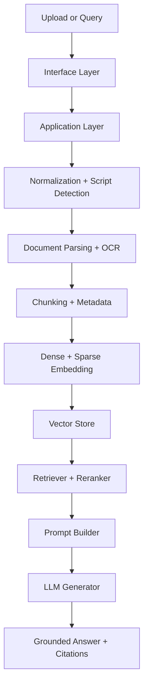

# VāṇiVerse Architecture

## 1. Purpose

VāṇiVerse is a multilingual, source-grounded retrieval and generation platform for Indic knowledge systems. The system is designed to support Telugu, Romanized Telugu, English, and mixed-script queries without losing provenance or cultural context.

The objective is to make historical, literary, cultural, and educational knowledge retrievable in a way that is faithful to source text, linguistically aware, and grounded in evidence rather than model memory.

---

## 2. Architectural goals

1. Script-aware retrieval for Indic languages
2. Robust handling of Telugu and Romanized Telugu input
3. Source-grounded answer generation with explicit citations
4. Modular and testable design
5. Support for multilingual and multimodal expansion
6. Clear separation between domain logic, infrastructure, and interface concerns

---

## 3. Core principles

### 3.1 Clean Architecture

The code should keep the following separation:

- Domain layer: knowledge concepts, entities, and rules
- Application layer: use cases and orchestration
- Infrastructure layer: storage, model adapters, OCR, and LLM integrations
- Interface layer: REST API and UI

This prevents business logic from being tied to framework-specific details and makes the system easier to evolve.

### 3.2 Evidence-first generation

The model must answer only from retrieved source blocks. This is a central requirement for cultural knowledge systems where hallucination is especially costly.

### 3.3 Indic-language awareness

The system must handle:

- native Telugu text
- Romanized Telugu text
- English queries
- mixed-script text
- transliteration and normalization variation

### 3.4 Explainability and provenance

Every response should retain source attribution and traceability back to the underlying document chunk.

---

## 4. High-level system flow



---

## 5. Layered design

### 5.1 Domain layer

The domain layer defines the core entities and contracts.

- `DocumentEntity`: source file, metadata, document type, language, script
- `ChunkEntity`: chunk text, metadata, page reference, source, script
- `QueryIntent`: normalized query, language, script, expected answer language
- `RetrievedChunk`: chunk + score + source metadata
- `AnswerRecord`: final answer + citations + evidence trace

This layer should remain free from FastAPI, OCR library details, and vector-store implementation details.

### 5.2 Application layer

This layer is responsible for orchestrating use cases.

- `IngestDocumentUseCase`
- `NormalizeDocumentUseCase`
- `BuildIndexUseCase`
- `RetrieveRelevantChunksUseCase`
- `GenerateAnswerUseCase`
- `EvaluatePipelineUseCase`

The application layer coordinates domain rules and adapters while staying independent from concrete infrastructure implementations.

### 5.3 Infrastructure layer

This layer contains the concrete systems that connect the application to external capabilities.

- PDF parser and OCR adapter
- Unicode and transliteration engine
- BGE-M3 embedding adapter
- FAISS / Qdrant vector-store adapters
- Groq / Ollama model adapters
- evaluation and telemetry adapters

### 5.4 Interface layer

The interface layer exposes the system to the outside world.

- FastAPI REST endpoints
- Streamlit UI
- CLI ingestion tasks
- admin and benchmarking tools

---

## 6. Core runtime flow

### 6.1 Ingestion pipeline

```text
Document Upload
  -> Parse file
  -> Detect document structure
  -> Normalize Unicode and script
  -> Segment into chunks
  -> Add metadata (source, page, language, script)
  -> Embed chunks
  -> Store vectors and metadata
```

### 6.2 Query pipeline

```text
User query
  -> Detect script and language
  -> Normalize query
  -> Transliterate Romanized Telugu if needed
  -> Embed query
  -> Retrieve relevant chunks
  -> Rerank and filter
  -> Build source-grounded prompt
  -> Generate answer with citations
  -> Return response + evidence
```

---

## 7. Indic-language handling requirements

### 7.1 Script detection

The system must distinguish:

- Telugu script text
- Romanized Telugu input
- English input
- mixed-script queries and documents

This distinction decides whether transliteration is required and whether the answer should be returned in Telugu or English.

### 7.2 Unicode normalization

Indic documents are highly sensitive to:

- zero-width characters
- broken ligatures
- malformed combining marks
- PDF extraction artifacts

The normalization layer must repair common artifacts before embedding or retrieval.

### 7.3 Transliteration policy

Romanized Telugu should only be transliterated when the query is actually in Romanized Telugu, not when the query is genuine English. This prevents semantic corruption of English questions that happen to contain common words such as "what", "who", and "is".

---

## 8. Retrieval architecture

### 8.1 Dense retrieval

The dense retrieval layer should use a multilingual embedding model that supports cross-script similarity, with BGE-M3 as the baseline choice.

Benefits:

- semantic matching across scripts
- better recall for transliterated Indian language queries
- support for cross-lingual retrieval

### 8.2 Hybrid retrieval

A hybrid strategy is recommended for production:

- dense embedding similarity for semantic matching
- sparse lexical features for exact lexical alignment
- reranking for final candidate selection

This improves recall and precision for heritage content where terminology may vary widely across scripts and forms.

### 8.3 Metadata-aware retrieval

Filtering by source, page number, language, or script provides useful control and improves provenance for culture-sensitive use cases.

---

## 9. Generation architecture

The generation layer should be strict, explainable, and conservative.

### Required behaviors

- answer only from retrieved source blocks
- cite each claim with a source label
- abstain if unsupported by evidence
- match answer language to query language when appropriate
- preserve native Telugu script when quoting source text

### Prompting policy

The prompt should include:

- system prompt that enforces evidence-only behavior
- explicit source blocks with labels
- query text
- instruction that citations are mandatory
- abstention rule when evidence is absent

---

## 10. Multimodal considerations

VāṇiVerse may eventually need to ingest scanned documents, manuscripts, and images. However, multimodal processing should be added as a modular extension rather than treated as the default path for all data.

Recommended staged approach:

1. text-first retrieval as the primary flow
2. OCR for degraded or scanned documents
3. optional image captioning or document layout embeddings
4. combined retrieval over text and image-derived metadata

This balances recall with operational complexity.

---

## 11. Evaluation architecture

The system should evaluate both retrieval and generation quality.

### Retrieval evaluation

- Recall@k
- MRR@k
- nDCG@k
- MAP
- hit rate

### Generation evaluation

- Exact Match
- F1 score
- semantic similarity
- groundedness
- hallucination rate
- citation precision
- citation recall

### Indic-language evaluation

- script fidelity
- transliteration accuracy
- mixed-script robustness
- language consistency
- abstention accuracy

Evaluation must be stratified by language and source type to reflect real deployment conditions.

---

## 12. Recommended roadmap

The project should evolve in stages. **The authoritative version — with tasks, exit criteria and live
status — is [ROADMAP.md](ROADMAP.md)**; this is a summary of that same six-milestone sequence.

### Milestone 1: Foundation & stability — ✅ complete

- stabilize the RAG pipeline
- improve script detection and transliteration
- validate retrieval quality on Telugu and English queries
- add evaluation harness

### Milestone 2: Retrieval quality & evaluation — ✅ complete

- benchmark datasets for Telugu and Romanized Telugu queries
- retrieval metrics (recall@k, MRR) and a source-grounded refusals study
- per-language reporting so the weakest path is visible

### Milestone 3: Robustness & document handling — 🔄 in progress

- improve OCR and PDF parsing
- strengthen chunking for long-form heritage documents
- refine citation behavior and answer grounding
- add document provenance metadata

### Milestone 4: Cultural intelligence — planned

- inscription and historical-document understanding
- heritage knowledge graph
- community contribution workflows

### Milestone 5: Indic expansion — planned

- support more Indian languages
- add domain-specific evaluation datasets

### Milestone 6: Production readiness — planned

- extend support for scanned manuscripts and images
- add more robust indexing and observability
- support deployment-grade evaluation and monitoring

---

## 13. Final recommendation

VāṇiVerse should remain a grounded, multilingual, script-aware retrieval system built around evidence-first question answering. The current repo already has a promising foundation; the next priority is to formalize clean architecture boundaries, improve quantitative evaluation, and keep multimodal expansion optional and incremental rather than destabilizing the core text-first pipeline.
