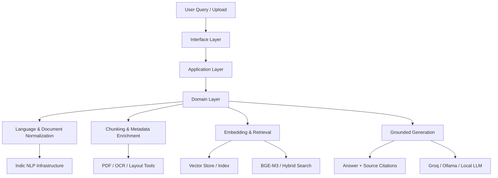

# VāṇiVerse — Design Notes

Long-form design rationale kept out of the [README](../README.md) so the README stays
scannable. This material was previously inlined in the README and is preserved here
verbatim; it is background and forward-looking design thinking, **not** a description of
shipped behaviour. For the implemented architecture see
[ARCHITECTURE.md](ARCHITECTURE.md), and for current status see the
[README](../README.md#known-limitations).

---

## Clean Architecture Blueprint for Indic-Language RAG

VāṇiVerse already has a strong RAG foundation. The current repository clearly follows the right direction: script-aware normalization, Telugu-aware chunking, multilingual embeddings, FAISS retrieval, and grounded generation. The next step is to formalize the architecture according to clean architecture principles so the system remains modular, maintainable, and extensible for India's diverse linguistic ecosystems.

### Repository assessment

What the project already does well:

* Detects script and normalizes inputs in `ingestion/normalizer.py`
* Uses Telugu-aware sentence segmentation and overlap-aware chunking in `ingestion/chunker.py`
* Embeds text through BGE-M3 in `retrieval/embeddings.py`
* Stores and retrieves vectors through a pluggable FAISS / Qdrant backend in `retrieval/vector_store.py`
* Builds grounded prompts with explicit source labels in `reasoning/prompter.py`
* Orchestrates the end-to-end flow through FastAPI in `api/main.py`

The main architectural gap is not model choice, but separation of concerns. For Indic-language knowledge systems, the critical responsibilities must be isolated cleanly: language detection, transliteration, document parsing, chunking, retrieval, answer synthesis, and evaluation.

### Clean layered architecture

### Layered responsibilities

#### 1. Domain Layer
The domain layer defines the business concepts of the system and should remain independent of frameworks or storage details.

* `DocumentEntity` — source file, metadata, language, script, provenance
* `ChunkEntity` — normalized chunk text, page number, source, script, chunk id
* `QueryIntent` — user query, script, language, expected answer language
* `RetrievalResult` — chunk id, score, metadata, source citation
* `SourceCitation` — explicit source attribution for answer verification

#### 2. Application Layer
This is the orchestration layer for use cases.

* `IngestDocumentUseCase`
* `NormalizeDocumentUseCase`
* `CreateIndexUseCase`
* `SearchUseCase`
* `AnswerQueryUseCase`
* `EvaluatePipelineUseCase`

These services coordinate domain objects without embedding storage or HTTP concerns.

#### 3. Infrastructure Layer
This layer contains adapters to external systems.

* PDF parsing and OCR adapters
* Unicode and transliteration services
* Embedding model wrappers
* Vector store adapters (FAISS / Qdrant)
* LLM adapters (Groq / Ollama)
* Telemetry and evaluation sinks

#### 4. Interface Layer
This is where user interaction is exposed.

* FastAPI REST endpoints
* Streamlit frontend
* CLI ingestion scripts
* external dashboards or admin panels

---

---

## End-to-end Indic-language RAG workflow

### 1. Ingestion
The ingestion workflow should accept many types of heritage data:

* PDFs and scanned manuscripts
* OCR output from historical documents
* notes and text dumps
* bilingual or mixed-script documents
* references from cultural repositories

The ingestion pipeline should capture:

* filename and provenance
* document type
* source region
* language and script metadata
* page structure and layout clues

### 2. Parsing and OCR normalization
The repository already includes parsing and normalization modules, which is excellent for Indic content. The effective pipeline is:

1. parse PDF or text source
2. extract text and layout structure
3. detect OCR noise and broken Unicode
4. normalize script-specific artifacts
5. preserve metadata for later retrieval and citation

This is especially critical for Telugu because PDF extraction often introduces broken ligatures, malformed matras, and zero-width characters.

### 3. Script-aware normalization
The normalization pipeline must decide whether a document or query is:

* Telugu script
* Romanized Telugu
* English
* mixed-script
* unknown

It should then apply the correct behavior:

* Telugu text: preserve script and clean Unicode
* Romanized Telugu: transliterate safely to Telugu for retrieval
* English: avoid accidental transliteration
* mixed-script: route carefully to preserve language context

This is the heart of the system and is consistent with the logic already implemented in `ingestion/normalizer.py`.

### 4. Chunking with Indic-aware boundaries
Chunking should not be generic token-based splitting alone. For Indic-language documents, sentence boundaries and context windows matter more.

Recommended chunking strategy:

* Telugu punctuation-aware segmentation (`।`, `॥`, `!`, `?`)
* overlap between adjacent chunks to preserve context
* metadata-rich chunks with source, page, language, and script
* paragraph-aware grouping for prose and verse

This is already well-aligned with the current chunker design in `ingestion/chunker.py`.

### 5. Embedding and indexing
The system uses BGE-M3 and a vector store, which is a strong fit for multilingual and cross-lingual retrieval. Recommended flow:

* encode chunks with multilingual dense embeddings
* optionally compute sparse lexical weights for hybrid retrieval
* store metadata with each vector
* index by source, script, language, and page metadata when needed

This allows the system to retrieve semantically relevant passages even when the query is written in a different script or transliterated form.

### 6. Retrieval and reranking
The retrieval stage should:

* detect the query script
* normalize the query
* embed it in the same multilingual space
* retrieve the top candidates
* rerank with lexical or semantic relevance
* filter by source and script when required

This gives better recall and reduces false matches for culturally dense or domain-specific documents.

### 7. Grounded answer generation
The answer layer should enforce a strict source-grounded contract:

* answer only using retrieved evidence
* cite each claim with source labels
* abstain when evidence is missing
* preserve the user's expected language or script
* avoid fabricating dates, names, verses, or historical facts

This is already encoded in `reasoning/prompter.py` and is one of the strongest design choices in the repository.

---

---

## Multimodal and multilingual trade-offs

### Multimodal processing trade-offs
Indic heritage collections often include more than raw text:

* scanned manuscripts
* inscriptions on temple walls
* handwritten notes
* mixed page layouts
* image-heavy historical documents

Benefits of multimodal processing:

* better extraction for non-text pages
* more complete coverage of heritage content
* support for OCR-heavy or image-based historical material

Costs:

* higher latency and compute cost
* OCR errors and noisy transcripts
* complex evaluation and provenance handling
* larger indexing and storage footprint

Recommended strategy:

* keep text-first retrieval as the default path
* add OCR and image-aware processing as an optional pipeline for scanned or degraded documents
* ingest OCR text and image-level metadata into the same retrieval corpus
* never let multimodal features compromise retrieval stability for the core transliterated text use case

### Multilingual input trade-offs
Indic-language systems must support a very different kind of variability than English-centric RAG systems:

* Telugu vs Romanized Telugu
* mixed Hindi-English or Telugu-English phrases
* transliterated names
* code-switching in real user queries
* script-drift in historical documents

Trade-offs between monolingual and multilingual approaches:

#### Single shared multilingual index
Pros:

* simpler architecture
* better cross-language semantic matching
* lower operational complexity

Cons:

* weaker language-specific precision
* more risk of mixed-script confusion
* answer generation can drift in script or language policy

#### Language-specific indexes with routing
Pros:

* better precision and language targeting
* simpler per-language evaluation
* easier to tune retrieval thresholds per language

Cons:

* more engineering complexity
* requires an explicit routing strategy
* harder to maintain consistent global metadata

Recommended hybrid approach:

* use a shared multilingual embedding model for the base retrieval layer
* add language-specific metadata routing
* optionally maintain per-language sub-indexes for sensitive domains
* keep a single source-of-truth for provenance and citation

---

---

## Evaluation framework and metrics

A strong Indic-language RAG system must evaluate both retrieval quality and answer correctness. For VāṇiVerse, the evaluation should be separated into at least three layers: retrieval, generation, and language fidelity.

### Retrieval metrics

* `Recall@k` — how many relevant chunks appear in the top k results
* `MRR@k` — mean reciprocal rank of the first relevant result
* `nDCG@k` — ranking quality with graded relevance
* `MAP` — average precision across queries
* `Hit Rate` — percentage of queries with at least one valid retrieval hit

These metrics help assess whether the vector index is truly retrieving the right cultural and linguistic evidence.

### Answer quality metrics

* `Exact Match (EM)` — strict matching for factoid answers
* `F1 Score` — token overlap between model response and expected answer
* `BERTScore` or semantic similarity — useful for paraphrased answers
* `Groundedness` — percentage of claims supported by retrieved evidence
* `Hallucination Rate` — percentage of unsupported statements
* `Citation Precision` — proportion of cited sources that were actually used
* `Citation Recall` — proportion of supporting material the system cites

### Indic-language-specific metrics
These are critical for VāṇiVerse because generic English-centric QA metrics do not fully capture the user experience.

* `Script Fidelity` — whether the answer uses the correct script
* `Transliteration Accuracy` — whether Romanized Telugu queries map to the correct Telugu answer
* `Mixed-script Robustness` — success rate on Telugu-English prompts and code-switched inputs
* `Language Consistency Score` — answer language matches query policy
* `Abstention Accuracy` — model correctly says the information is unavailable when evidence is absent

### Evaluation strategy

The evaluation set should be stratified by:

* Telugu-native queries
* Romanized Telugu queries
* English queries
* mixed-script queries
* domain category (history, philosophy, literature, ritual, education)
* source type (PDF, OCR, manuscript, text dump)

This ensures the system is measured on the actual problem distribution it will face in production.

---

---

## Recommended production architecture for VāṇiVerse

The clean production direction is:

1. Keep a multilingual dense retrieval foundation using BGE-M3.
2. Add hybrid retrieval with lexical and semantic ranking.
3. Add explicit language and script detection before indexing and querying.
4. Separate the ingestion and retrieval layers from the answer generation layer.
5. Treat citation and source grounding as first-class requirements.
6. Add evaluation pipelines that continuously measure retrieval, answer quality, and script fidelity.
7. Keep multimodal support as an optional extension rather than a default dependency for all content.

This keeps the system robust, explainable, and aligned with the cultural-preservation mission behind VāṇiVerse.

---
